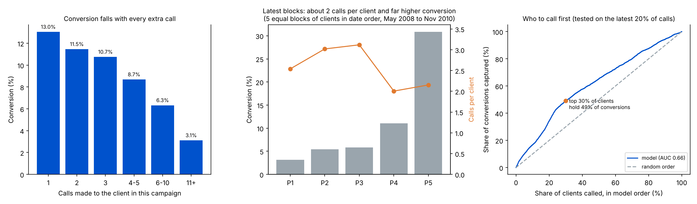

# Fintech Deposit Campaign: Conversion Drivers, Call Fatigue and Experiment Design

A product-analytics study of a real phone-sales campaign for a **term-deposit (fixed-deposit) product**: what drives conversion, how much calling effort is wasted, who to call first, and how to test a better policy before rolling it out.

**Data:** the UCI *Bank Marketing* dataset (Moro, Cortez & Rita, 2014): **41,188 clients** of a Portuguese bank, called between May 2008 and Nov 2010, with whether each subscribed to a term deposit. The rows are in date order, so the model can be tested on later months it never saw.



## Key findings

| Area | Finding | Product lever |
|---|---|---|
| Funnel | **4,640** of 41,188 clients converted (**11.3%**), from **105,754** calls: **22.8 calls per conversion**, or 4.4 conversions per 100 calls. | Conversions per 100 calls is the efficiency KPI to move |
| Call fatigue | Conversion falls with every extra call: **13.0%** for clients reached in one call, **8.7%** at 4–5 calls and **3.1%** at 11+. | Cap repeat attempts and move effort to fresh, high-intent clients |
| Cap on attempts | A **5-call cap** removes **15%** of calls and puts at most **4%** of conversions at risk, lifting conversions per 100 calls by **12%** even in the worst case. A 3-call cap removes 27% of calls but risks 12% of conversions. | Start with a 5-call cap; test 3 calls only for low-score clients |
| Channel | Mobile numbers convert at **14.7%** against **5.2%** for landlines (**2.8x**). | Prioritise mobile reach (or app and WhatsApp nudges) over landlines |
| Past behaviour | Clients who said yes in a previous campaign convert at **65%**, **5.8x** the average. | Past engagement is the strongest intent signal; target it first |
| Over time | The latest fifth of clients converted at **31%**, against **3%** for the earliest, with about **2 calls per client** (down from 3.1) and mobile reach up from **0% to 88%**. | Fewer, better-targeted calls beat volume |
| Who to call first | A pre-call model, trained on the earliest 80% of calls and tested on the latest 20%, ranks clients with AUC **0.66**: its top **30%** hold **49%** of conversions and convert at **50%**, against a **31%** base rate (**1.6x**). | Call in score order; the model works without knowing call length |
| Experiment | To detect a **+1.5 pp** lift on the 11.3% base rate at 5% significance and 80% power needs **7,372 clients per arm**. | Test the new calling policy against a holdout before scaling |

## The policy I would test

**Hypothesis:** calling clients in model-score order, with a 5-call cap, raises conversions per 100 calls without lowering total conversions.

| | |
|---|---|
| Control | Today's calling order, no cap |
| Treatment | Score order, 5-call cap, mobile numbers first |
| Primary metric | Conversions per 100 calls |
| Guardrails | Total conversions; complaint and do-not-call rate; calls per client |
| Sample size | 7,372 clients per arm for a +1.5 pp lift (4,220 for +2 pp) |
| Decision rule | Scale if conversions per 100 calls rise and total conversions do not fall by more than the 4% worst case |

## What this means for a fintech app

The same pattern shows up in any assisted-sales or nudge-driven funnel: FD and loan sales calls, margin-trading upsell, or app notifications to first-time investors.

1. **Every extra touch converts worse.** Frequency caps protect both conversion efficiency and customer trust.
2. **Past engagement predicts intent best.** A user who has acted before is worth contacting first.
3. **Measure efficiency, not volume.** Conversions per contact, tested against a holdout, shows whether a change really works.

## Method

- **Data checks:** 12 exact duplicate rows (kept, as identical clients can exist), no missing values, and 12,718 "unknown" values, kept as their own category.
- **Call cap:** each row is a client, and `campaign` counts calls to that client, including the last one. Under a cap of K calls: calls saved = Σ max(campaign − K, 0); conversions at risk = converters with more than K calls. This is a worst case, as some of those clients might have converted earlier with better timing.
- **Model:** `HistGradientBoostingClassifier` on client, product-holding, channel, timing, previous-campaign and economic features. **Call duration is excluded**, because it is only known after the call ends and would leak the outcome; the number of calls is excluded too, so the model can rank clients before any call. Adding the economic indicators moves AUC only from 0.65 to 0.66.
- **Sample size** (two-proportion test, per arm): n = (z_α + z_β)² × [p₁(1 − p₁) + p₂(1 − p₂)] ÷ (p₂ − p₁)², where p₁ = control conversion (11.3%), p₂ = treatment conversion, z_α = 1.96 for a two-sided 5% significance level, and z_β = 0.84 for 80% power.
- **SQL:** `sql/campaign_kpis.sql` rebuilds the headline KPIs, conversion by number of calls, channel and previous outcome, and the call-cap trade-off using CTEs, `CASE` and `UNION`. `run_sql.py` runs it in SQLite and checks every result against the Python analysis.

## Limitations

- One bank in one country between 2008 and 2010; the economic backdrop (the financial crisis and falling interest rates) shifted conversion over time, which is why the test months convert at 31%.
- The data is observational: the call-cap and targeting effects are estimates to test, not proven causal effects. The experiment above is how to prove them.
- AUC of 0.66 on later months is modest; the model ranks better within a period than across a shift in the economy, so it should be retrained often.

## Outputs

- `results/results.json`: every number in this README
- `results/summary.png`: the three charts above
- `sql/campaign_kpis.sql`: the KPI queries

## Run it

```bash
pip install pandas numpy scipy scikit-learn matplotlib
python get_data.py       # only if data/ is empty: downloads the data, checked against a fixed checksum
python run_analysis.py   # writes results/
python run_sql.py        # runs the SQL and checks it matches the Python results
```

## Data source

S. Moro, P. Cortez and P. Rita, "A Data-Driven Approach to Predict the Success of Bank Telemarketing", *Decision Support Systems*, 2014. UCI Machine Learning Repository: https://archive.ics.uci.edu/dataset/222/bank+marketing
